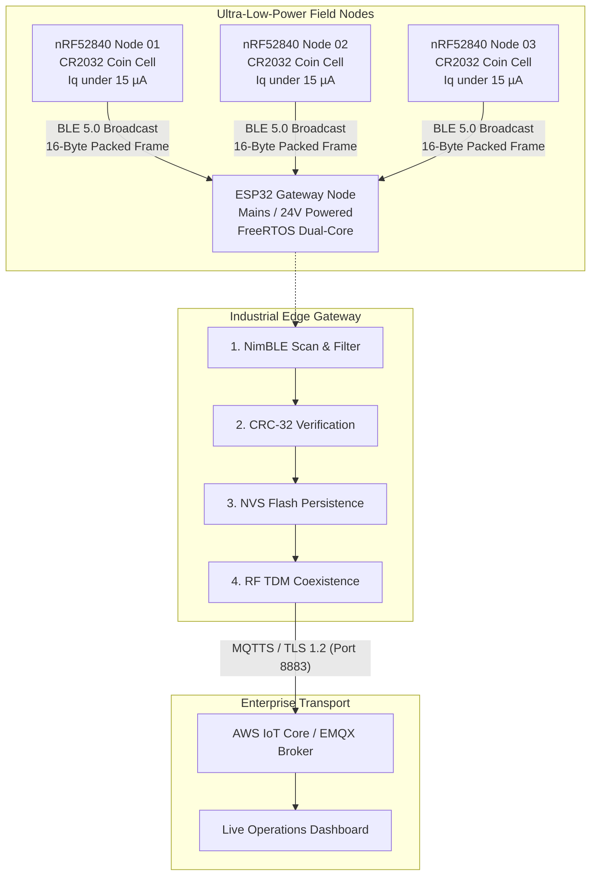

# 🏛️ Hybrid Nordic nRF52 & ESP32 Wireless Sensor Network Architecture

This document outlines the dual-platform topology combining **Nordic Semiconductor nRF52840** ultra-low-power field nodes with **Espressif ESP32** multi-protocol telemetry gateways.

---

## 1. Network Topology

---

## 2. Platform Roles & Engineering Decisions

### A. Nordic nRF52840 — Ultra-Low-Power Edge Node
* **Goal:** Maximum battery longevity (3+ years on a single $225\,\text{mAh}$ CR2032 coin cell).
* **Architecture:** Event-driven bare-metal / Zephyr firmware. The Cortex-M4F MCU remains in `SYSTEM_OFF` deep sleep ($< 1.5\,\mu\text{A}$), waking strictly upon external GPIO interrupts (Hall effect / reed switch) or a low-power RTC timer.
* **Transmission:** Broadcasts custom 16-byte manufacturer data frames via non-connectable BLE advertisements, eliminating connection handshake latency and RF power drain.

### B. Espressif ESP32 — 10-State Deterministic Gateway
* **Goal:** High-throughput packet ingestion, robust payload validation, and cloud MQTT delivery.
* **Hardware RF Coexistence:** Employs a software time-division multiplexer (TDM) so the single 2.4 GHz RF front-end is never simultaneously shared between active Wi-Fi TX bursts and NimBLE scanner windows, avoiding RF front-end desensitization.
* **Non-Volatile Storage (NVS):** Retains monotonically increasing pulse counters across brownouts or sudden mains power loss.
* **10-State Finite State Machine:** Fully deterministic lifecycle (`INIT`, `WIFI_CONNECT`, `MQTT_CONNECT`, `BLE_SCAN`, `VALIDATE_CRC`, `BUFFER_RECORD`, `DISPATCH`, `OTA_CHECK`, `SLEEP_IDLE`, `FAULT_RECOVERY`).
